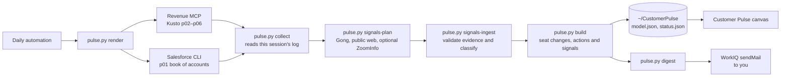

# Customer Pulse

A morning dashboard for the accounts you own in Salesforce. Each day it answers three questions across GitHub Enterprise (GHE), GitHub Advanced Security (GHAS) and GitHub Copilot:

- **What changed?** Contracted and used seats that were added or dropped since yesterday, per product.
- **What needs attention?** Risks, such as a renewal with falling usage or low adoption.
- **Where can I grow?** Opportunities, such as usage above contract or whitespace.

A daily automation refreshes the data, emails you a short digest of what is new, and updates a canvas in the GitHub Copilot app that you can click through for detail.

## What you see

| Tab | Shows |
| --- | --- |
| **Overview** | Separate ARR, observed Billed LTM, usage forecast and pipeline figures; product mix, 120-day renewal radar, actions and today's changes. |
| **Top 50** | Owned accounts ranked by ARR, observed billed LTM or renewal date; product billing/seats, closed-month consumption changes, health, SE issues, email and Gong-call recency, people/PoCs and recorded tech stack. Ties use name then ID; missing rank values go last. |
| **Account 360** | Full-page Summary, Commercial, Products & consumption, Security, Success & support and Activity sections. Open it from Top 50 or the existing account preview. |
| **Consumption** | Thirteen closed months of metered consumption billed USD per product (consumption invoices only, so not total product billing), matched-account comparisons and changes, plus metered, volume and Both customer counts. Metered comes from positive invoices on any channel (Zuora, azure) or metered MRR. Volume comes from license MRR or the GHE/GHAS contract and licensing models, each dated by its own source. Products without a volume source show Not available, and Copilot MRR without a Copilot invoice is counted separately rather than as volume. Code Security, Secret Protection, Code Quality and bundled GHAS have separate views even without invoice rows. |
| **Copilot** | Embedded adoption dashboard: account plays, usage, surfaces, models, Impact, forecasts and modeled whitespace. **Seats & actions** keeps Pulse's seat table, health mix, usage funnel, actions and changes. |
| **Impact** | The embedded dashboard's Copilot Impact view on its own tab: enterprise adoption phases, throughput, cost and ROI where the snapshot has them, and a clear empty state where it does not. |
| **GHE** | Contracted seats, metered and billable users, adoption and explicitly observed zero-seat whitespace; missing product rows are not whitespace. |
| **GHAS** | Component-specific billing trends and customer billing models, GHAS/Code Quality usage, parent-model whitespace and account-level repository/commit protection. The `#/ghas` link remains compatible. |
| **Pipeline & renewals** | Monthly renewals, license opportunities, revenue retention, budgets and renewal risk alongside health, usage and support. |
| **Signals** | Evidence-backed Gong, public-web and optional ZoomInfo signals, plus read-only Gainsight risks and urgent/high support escalations with coverage dates. Existing local actions remain separate. |
| **Recommendations** | Existing live Salesforce Account Recommender evidence; exact duplicate signal evidence is collapsed without fuzzy product matching. |
| **Data** | Accounts-by-source coverage, dates, collection failures and unavailable connections, plus existing detection rules and thresholds. |

Each product tab also lists that product's actions and seat changes. Click any account to open its detail panel: seats by product and type, its actions, its seat changes over the history window, Copilot health and usage, and account context such as billing and support.

The Copilot tab reads `model.json` and `dashboard.html` from `copilot_home` in Pulse config (default `~/CopilotConsumptionDashboard`). It embeds a same-origin dashboard at `/copilot/`; a fallback link opens it in its own tab. The account panel's **Open in Copilot dashboard** link selects that account in the embedded view. The standalone Copilot canvas is not replaced. All refresh buttons use Pulse's one configured refresh coordinator; no automation id is baked into the frontend.

Mark an action **Done** or **Dismiss** it once handled. The choice is stored locally (never in Salesforce), hides the action unless you tick *Show done*, and can be undone with **Reopen**.

Signals also appear in the account drawer and daily email. The header badge counts new verified High signals; **Needs verification** items stay in the feed but are excluded from the badge and email. Signals are emailed once, without the recurring-action reminder interval.

### Internal seller feeds

`seller-plan` and `seller-collect` add read-only internal data beneath an explicitly
selected `CP_HOME/seller/`. They do not send email, alter CRM records, mark actions,
change schedules, or install extensions. The existing refresh is unchanged unless
the optional collection stage in [REFRESH.md](REFRESH.md) is approved.

| Source | Coverage and limits |
| --- | --- |
| Existing Pulse / Copilot facts | AI-credit billing, Code Security/Secret Protection billing, parent-model GHE/Security potential seats/SOM and deployment. Parent estimates must not be summed across children. |
| `rev_source` | Consumption invoices, model costs, MRR, account-grain self-serve Team revenue, license opportunities, support and services. Team org names are not supplied by the account-grain fact. |
| C360 (experimental) | Actions rolling runner/job observations, repository/commit protection and revenue retention (not MAU retention). |
| Gainsight | Latest-per-entity risk CTAs, success-plan objectives/goals and timeline; dated sentiment. Sparse account matches can reflect parent/sibling CO attribution. |
| Revenue Salesforce tools / Contact SOQL | Linked SE issue metadata, PoCs, Gong participants, notes, partners and child accounts. Current issue status is not a historical status-transition log. |
| WorkIQ Outlook | Read-only email headers/threads over 180 days, searched per current (fresh, successfully collected) Salesforce Contact email. Only those verified contacts are stored as correspondents; other recipients are discarded. No bodies, drafts or sends. Capped/paginated results are rejected, not reported as complete. Outlook calendar is not read: the connector cannot scope calendar reads to attendees at source, so meetings come only from account-scoped Gong calls. Meetings without Gong recording are therefore not shown. |
| Enterprise budgets | Activity collects explicit enterprise/proxima namespace and slug via `get_salesforce_account`; the subsequent budgets group uses those mappings. Missing scope, omitted results or unrecognized responses are No data, not a guessed lookup. Per-user budgets are excluded. The API supplies no currency, so raw decimal amounts are labeled with unknown currency rather than inferred USD. |
| Tech stack | Only recorded **existing** language/CI/security-tool fields in internal PoCs. Tools merely evaluated or discussed are excluded. PoC end dates are not current detection dates. ZoomInfo is not connected. |

Account entitlement has not been established by the mere existence of a source.
Readiness labels distinguish already-collected fields from new internal feeds.
Missing rows show **No data**, never an invented zero. Failed/stale rows remain
inspectable but are excluded from current enrichment totals. Dollar figures carry
`[ARR]`, `[Billed]`, `[Usage est.]` or `[Model est.]`; distinct `[MRR]`, `[Booked]`,
`[Budget]`, `[Services est.]` and salary `[Assumption]` labels prevent conflating those measures.
Services expected revenue is identified separately from bookings. Invoiced units
remain separate by product, billing source and unit of measure; model actor counts
are never summed across slices. Billed LTM is an observed subtotal, with month
coverage; p06 LTM aggregates remain available when monthly invoices are absent.
Thirty/ninety-day billing views compare one/three **closed calendar months**, not
daily spend. Customer-admin reporting, alert severity/counts, per-user/team data,
customizations and agent outcomes are not added by these feeds.

Before live rollout, approve the extension update, private-to-published model
refresh and optional daily read-only collection change separately. Development
uses synthetic fixtures/private homes, never the installed extension or live raw,
model, snapshot or action-state files.

## How it works



| Query | Database | Used for |
| --- | --- | --- |
| `p01_universe.soql` | Salesforce | Your book: accounts you own, with type, industry, country and parent |
| `p02_contracted.kql` | service_sales_analytics | Contracted seats and ARR per product type per day |
| `p03_ghe_usage.kql` | rev_source | GHE metered users, volume billable users and GHEC monthly users |
| `p04_copilot.kql` | rev_source | Copilot assigned and at-risk users per day, latest health scores and contracted Copilot seats |
| `p05_ghas_cq.kql` | c360 | GHAS active committers per day and Code Quality usage |
| `p06_attributes.kql` | c360 | Account attributes: ARR, next renewal, adoption, Copilot usage funnel, product flags, billing and support |

Queries are templated with your owner id and a per-run nonce. `collect` only accepts a result whose query text matches the rendered file exactly and that ran in this session after the run started, so results from other sessions or edited queries are never mixed in.

C360's owned-account and attribute queries anchor their ten-day lookback to its latest published snapshot within the past 45 days, not to the refresh date. This preserves available attributes during an upstream publishing delay without treating them as fresh: status still uses the actual measurement date. A collected attributes feed with no dated C360 rows is marked suspect, not OK. Refreshing Pulse cannot advance an upstream measurement date; a stale feed can need its source pipeline restored.

Seat changes are compared day to day per product. A change that is undone within a few days is shown struck through, and a day whose load looks partial is held back rather than reported as churn. Sources that reload their whole recent history each day (GHE billable users and Copilot seats) are merged across days, so a late refresh adds the missing days without re-dating earlier ones. A zero-total placeholder a source leaves on an earlier date is never read as seats dropping to zero, and never replaces the real value an earlier refresh captured for that date. A contracted-seat drop is High only when it is large in seats, or large in percentage and at least a few seats, so a 1 → 0 change on a small account stays Medium. The Data tab explains each rule with your current thresholds.

The email lists only what is new since the last one sent: High items first, then seat changes and other actions, with up to ten per section and "+N more in the dashboard" beyond that. On a busy day it shows fewer per section to stay within the mail size limit. If the automation runs again the same day and nothing new has appeared, no second email is sent.

## Setup

1. **Sign in to Salesforce with the CLI.** p01 runs through `sf`; if it is unavailable the runbook falls back to the Revenue MCP.
   ```bash
   sf org login web --alias pulse-github --instance-url https://github.my.salesforce.com
   ```
2. **Create your config** in `~/CustomerPulse/config.json` (set `CP_HOME` to use another folder):
   ```bash
   python3 customer-pulse/pulse.py init-config \
     --owner-id <your 18-character Salesforce user id> \
     --owner-name "<your name as shown in Salesforce>" \
     --digest-to <your work email>
   ```
   `config.example.json` lists every key. Thresholds can be overridden under `thresholds`.
3. **Install the canvas.** See [canvas/README.md](canvas/README.md).
4. **Create the daily automation** in the GitHub Copilot app with a prompt such as *"Follow customer-pulse/REFRESH.md"*, with the revenue-mcp-server and workiq MCP servers available. Then store its id so the canvas Refresh button can start it:
   ```bash
   python3 customer-pulse/pulse.py init-config --workflow-id <automation id>
   ```

The automation builds from the default branch, so changes to this folder only take effect once merged.

## Commands

| Command | Does |
| --- | --- |
| `pulse.py render --new-run` | Starts a run and writes the queries to run, with their database and file. |
| `pulse.py collect` | Runs p01 through `sf` and saves this run's MCP results. Exit code 2 lists what is missing. |
| `pulse.py signals-plan` | Prints fixed account-scoped tool tasks and a strict record schema; default budget 25 calls. |
| `pulse.py signals-ingest --stdin` | Ingests a JSON array of <=5 records; `--source-status gong=ok` (or failed/not_connected) records source health. |
| `pulse.py build` | Rebuilds `model.json` and `status.json`. Exit code 1 keeps the previous dashboard; 3 means another run holds the lock. |
| `pulse.py digest` / `digest --mark-sent` | Writes today's email body, then records it as sent once the send appears in the session log. |
| `pulse.py status` | Prints each source's freshness. |
| `pulse.py privacy-scan [--all]` | Blocks staged lines that contain one of your account names or a Salesforce record id. |

See [REFRESH.md](REFRESH.md) for the exact steps the automation follows.

## Privacy

This repository is public. Config, raw query results, history and output all live in `~/CustomerPulse/`, never in the repo, and tests use synthetic data only. Before committing, run the privacy scan, or install it as a pre-commit hook:

```bash
hook="$(git rev-parse --git-path hooks)/pre-commit"
printf '#!/bin/sh\nexec python3 customer-pulse/pulse.py privacy-scan\n' > "$hook" && chmod +x "$hook"
```

Signal snippets (at most 300 characters), provenance, source status and company-id cache are stored atomically under `~/CustomerPulse/signals/`. Signals older than 180 days are rejected/pruned on ingest and pruned again on build even if collection failed. LinkedIn is never accessed. External content is treated only as data and is HTML-escaped in email and rendered as text in the canvas; links require HTTPS. Unavailable signals never block telemetry build or the email. Optional sources that have never run do not downgrade telemetry health, but remain visible in Data.

Set `gong_email` with `pulse.py init-config --gong-email <your Gong participant address>`; it is independent of `digest_to`. The `signals` config block deep-merges defaults: top 50 by ARR, 10 web accounts/day, three-day participant lookback, weekly account sweep, three calls/account, 25 daily tool calls, ZoomInfo disabled, 180-day retention and 300-character evidence. Smaller retention/snippet limits are allowed; privacy caps cannot be raised. Competitor aliases can be edited using `signals.competitors` (brand -> array of word-boundary phrases); omitted aliases use `pulse/signals.py`. Theme keyword rules and suggested GitHub plays are also in that module.

ZoomInfo is **Not connected** until enabled and connected separately. Enrichment can consume credits; the planner caches exact-name company matches from session results and batches at most ten ids. If a budget defers tasks, the report must call it out. Do not mark a partially completed source OK.

## Tests

```bash
cd customer-pulse && python3 -m unittest discover -s tests
node --test customer-pulse/canvas/tests/
```

## Signals classification

Competitors are matched on word boundaries, including GitGuardian. Claude models inside Copilot are not competitors; bare Claude requires explicit coding-tool context. Fixed themes cover agentic SDLC, organization-wide skills, productivity/AI ROI, AppSec/supply chain, platform engineering, modernization, CI/CD speed and code quality. Each has a concrete GitHub play. Gong calls without a competitor or theme are skipped (a GitHub mention alone is not a signal there).

The engine verifies quoted evidence against matching tools in the current session after planning, binds Gong evidence to the call id/account/date, and requires a returned citation for web links. It never accepts an agent-supplied priority, reason, play or confidence. See [REFRESH.md](REFRESH.md) for the non-blocking signals step between collection and build.
