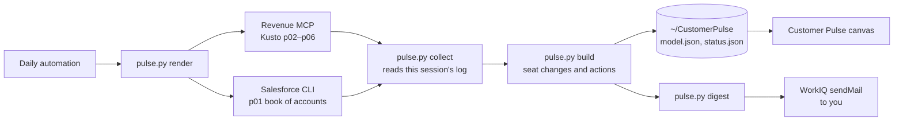

# Customer Pulse

A morning dashboard for the accounts you own in Salesforce. Each day it answers three questions across GitHub Enterprise (GHE), GitHub Advanced Security (GHAS) and GitHub Copilot:

- **What changed?** Contracted and used seats that were added or dropped since yesterday, per product.
- **What needs attention?** Risks, such as a renewal with falling usage or low adoption.
- **Where can I grow?** Opportunities, such as usage above contract or whitespace.

A daily automation refreshes the data, emails you a short digest of what is new, and updates a canvas in the GitHub Copilot app that you can click through for detail.

## What you see

| Tab | Shows |
| --- | --- |
| **Overview** | Headline numbers, open actions (High first), recent seat changes, upcoming renewals, a card per product, and every account with its seats and most urgent item. |
| **Copilot** | Embedded adoption dashboard: account plays, usage, surfaces, models, Impact, forecasts and modeled whitespace. **Seats & actions** keeps Pulse's seat table, health mix, usage funnel, actions and changes. |
| **GHE** | Contracted seats, metered and billable users, and adoption per account, plus accounts without GHE. |
| **GHAS** | Contracted seats, active committers and utilization, code and secret scanning coverage, licensing model and Code Quality, plus GHE accounts without GHAS. |
| **Signals** | Reserved for conversation, news and public-web signals (see [Roadmap](#roadmap)). |
| **Data** | Each source's freshness, how seat changes are detected, the action rules and every threshold. |

Each product tab also lists that product's actions and seat changes. Click any account to open its detail panel: seats by product and type, its actions, its seat changes over the history window, Copilot health and usage, and account context such as billing and support.

The Copilot tab reads `model.json` and `dashboard.html` from `copilot_home` in Pulse config (default `~/CopilotConsumptionDashboard`). It embeds a same-origin dashboard at `/copilot/`; a fallback link opens it in its own tab. The account panel's **Open in Copilot dashboard** link selects that account in the embedded view. The standalone Copilot canvas is not replaced. All refresh buttons use Pulse's one configured refresh coordinator; no automation id is baked into the frontend.

Mark an action **Done** or **Dismiss** it once handled. The choice is stored locally (never in Salesforce), hides the action unless you tick *Show done*, and can be undone with **Reopen**.

## How it works



| Query | Database | Used for |
| --- | --- | --- |
| `p01_universe.soql` | Salesforce | Your book: accounts you own, with type, industry, country and parent |
| `p02_contracted.kql` | service_sales_analytics | Contracted seats and ARR per product type per day |
| `p03_ghe_usage.kql` | rev_source | GHE metered users, volume billable users and GHEC monthly users |
| `p04_copilot.kql` | rev_source | Copilot assigned and at-risk users per day, latest health scores and contracted Copilot seats |
| `p05_ghas_cq.kql` | c360 | GHAS active committers per day and Code Quality usage |
| `p06_attributes.kql` | c360 | Account attributes: ARR, next renewal, adoption, Copilot usage funnel, product flags, billing and support |

Queries are templated with your owner id and a per-run nonce. `collect` only accepts a result whose query text matches the rendered file exactly and that ran in this session after the run started, so results from other sessions or edited queries are never mixed in.

Seat changes are compared day to day per product. A change that is undone within a few days is shown struck through, and a day whose load looks partial is held back rather than reported as churn. Sources that reload their whole recent history each day (GHE billable users and Copilot seats) are merged across days, so a late refresh adds the missing days without re-dating earlier ones. A contracted-seat drop is High only when it is large in seats, or large in percentage and at least a few seats, so a 1 → 0 change on a small account stays Medium. The Data tab explains each rule with your current thresholds.

The email lists only what is new since the last one sent: High items first, then seat changes and other actions, with up to ten per section and "+N more in the dashboard" beyond that. On a busy day it shows fewer per section to stay within the mail size limit. If the automation runs again the same day and nothing new has appeared, no second email is sent.

## Setup

1. **Sign in to Salesforce with the CLI.** p01 runs through `sf`; if it is unavailable the runbook falls back to the Revenue MCP.
   ```bash
   sf org login web --alias pulse-github --instance-url https://github.my.salesforce.com
   ```
2. **Create your config** in `~/CustomerPulse/config.json` (set `CP_HOME` to use another folder):
   ```bash
   python3 customer-pulse/pulse.py init-config \
     --owner-id <your 18-character Salesforce user id> \
     --owner-name "<your name as shown in Salesforce>" \
     --digest-to <your work email>
   ```
   `config.example.json` lists every key. Thresholds can be overridden under `thresholds`.
3. **Install the canvas.** See [canvas/README.md](canvas/README.md).
4. **Create the daily automation** in the GitHub Copilot app with a prompt such as *"Follow customer-pulse/REFRESH.md"*, with the revenue-mcp-server and workiq MCP servers available. Then store its id so the canvas Refresh button can start it:
   ```bash
   python3 customer-pulse/pulse.py init-config --workflow-id <automation id>
   ```

The automation builds from the default branch, so changes to this folder only take effect once merged.

## Commands

| Command | Does |
| --- | --- |
| `pulse.py render --new-run` | Starts a run and writes the queries to run, with their database and file. |
| `pulse.py collect` | Runs p01 through `sf` and saves this run's MCP results. Exit code 2 lists what is missing. |
| `pulse.py build` | Rebuilds `model.json` and `status.json`. Exit code 1 keeps the previous dashboard; 3 means another run holds the lock. |
| `pulse.py digest` / `digest --mark-sent` | Writes today's email body, then records it as sent once the send appears in the session log. |
| `pulse.py status` | Prints each source's freshness. |
| `pulse.py privacy-scan [--all]` | Blocks staged lines that contain one of your account names or a Salesforce record id. |

See [REFRESH.md](REFRESH.md) for the exact steps the automation follows.

## Privacy

This repository is public. Config, raw query results, history and output all live in `~/CustomerPulse/`, never in the repo, and tests use synthetic data only. Before committing, run the privacy scan, or install it as a pre-commit hook:

```bash
hook="$(git rev-parse --git-path hooks)/pre-commit"
printf '#!/bin/sh\nexec python3 customer-pulse/pulse.py privacy-scan\n' > "$hook" && chmod +x "$hook"
```

## Tests

```bash
cd customer-pulse && python3 -m unittest discover -s tests
node --test customer-pulse/canvas/tests/
```

## Roadmap

- **Copilot tab:** embed the full Copilot Adoption dashboard (`copilot-consumption-dashboard/`) and add newer Copilot metrics.
- **Signals:** Gong call themes, ZoomInfo intent and news, and public web posts, analysed for engineering and business priorities that GitHub can help with. Competitor mentions and priorities GitHub solves are marked High. LinkedIn is not monitored, because its terms do not allow automated reading of member posts.
